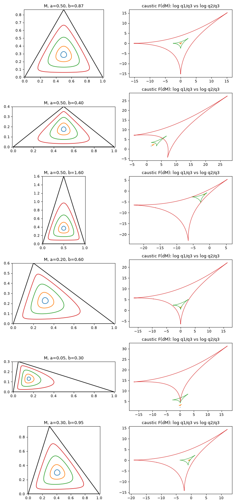

# Maxwell's conjecture for three positive point charges

> **Theorem (computer-assisted).** Three positive point charges in ℝ³ with the Coulomb
> potential have at most **4** isolated equilibrium points. Generically there are exactly
> 2 or 4.

This is Maxwell's (n−1)² bound for n = 3, for positive charges. Gabrielov, Novikov,
Novikov and Shapiro (arXiv:2607.28785, July 2026) brought the best known bound down from
12 to **6** and noted that closing the gap "would be equivalent to Maxwell's conjectured
bound for three charges". This repository presents a proposed computer-assisted proof closing that gap for the Coulomb potential.

**Status.** The argument combines rigorous mathematics ([`notes/theory.md`](notes/theory.md))
with a rigorous interval-arithmetic certificate. The certificate checks four explicit
strict inequalities on a compact 4-parameter domain:
- `cert_s1.0.json`: 9,965,924 boxes, **0 unresolved**;
- `cert_s1.0_n10.json`: 9,966,320 boxes from a different subdivision, **0 unresolved**;
- `cert_base_triangle.json`: 2,356 boxes on the fixed base triangle, **0 unresolved**.

The two main runs use the same interval implementation. Logs, parameters, runtime
versions and source hashes are in [`certificates/review-2026-11-10/`](certificates/review-2026-11-10/).
A second base-triangle run (1,618 boxes) also passed. The runs recorded with the earlier
sources have the same box counts; they are kept in `certificates/review-2026-10-30/` and
`certificates/rerun-2026-10-31/` (see [`certificates/README.md`](certificates/README.md)).
These JSON files summarize verified executions; they are not leaf-by-leaf certificates
for a separate checker.

A second implementation, written from the paper alone and sharing no code with the first
([`independent/`](independent/)), certified the same inequalities on the whole domain:
84,329,540 boxes, **0 unresolved**, and 1,279 boxes for the base triangle.

It has **not** been peer-reviewed. Two AI-assisted reviews are documented, both in Italian:
- [`paper/REVIEW.md`](paper/REVIEW.md) (30–31 October 2026, GPT-6-Astra in OpenAI Codex)
  found and fixed three defects in the interval verification;
- [`paper/REVIEW-2026-11-09.md`](paper/REVIEW-2026-11-09.md) (9–10 November 2026, Claude
  Fable 5.2) checked the mathematics and the closed forms, wrote the second implementation,
  and found a latent defect in the range handling of sin and cos and an unused non-rigorous
  code path. Both are fixed, and its remarks on exposition, references and the diagnostic
  figures were taken into account in the paper of 10 November 2026. Still open: the
  exact statement of Martinez-Maure's Theorem 2 has not been checked by an AI reviewer
  against the full text, and two optional suggestions (a self-test of the arithmetic
  environment, and a proof of the total turning that does not use (W)).

None of this changed the outcome, and neither review replaces an independent human expert.
Please read the caveats below.

**Paper.** [`paper/paper.pdf`](paper/paper.pdf) (source `paper/paper.html`, built with
`paper/build.ps1`; figures from `paper/figures.py`). See the [build instructions](paper/README.md).

## Background

- Maxwell (*Treatise*, 1873) conjectured at most (n−1)² equilibria for n point charges.
- For general n this is false: Arathoon, Ball and Kvalheim (2026) found 5 charges with ≥ 24.
- For n = 3:
  - Gabrielov, Novikov and Shapiro (2007) proved ≤ 12 for positive charges;
  - the 2026 preprint above proved ≤ 6 nondegenerate equilibria;
  - Tsai (2015) proved ≤ 4 for charges of equal magnitude.

## The argument in brief

1. For non-collinear charges, all equilibria lie inside the triangle they span. For nondegenerate parameters their number is
   2 + 2·(number of local minima of V in the plane). So the claim is
   **at most one local minimum**.
2. **Lami's theorem.** x is an equilibrium only for the charges q ∝ (λᵢ rᵢ^{s+2}), with λ
   the barycentric coordinates of x. The Hessian there is ∝ (s+2)T − I, with T = Σλᵢuᵢuᵢᵀ.
   So x is a nondegenerate planar minimum iff |Z(x)| < κ = s/(s+2) (κ = 1/3 for Coulomb), where
   **Z(x) = Σ λᵢ uᵢ²** in complex notation.
3. **Gauss-map picture.** V_q = ⟨q, Φ⟩ is a height function on the surface S = Φ(triangle),
   with Φ = (r₁^{−s}, r₂^{−s}, r₃^{−s}). So x ↦ [q] is the Gauss map of S, and M = {|Z| < κ}
   is its elliptic region. The number of minima equals the winding number of the
   **caustic** C = F(∂M) around q.
4. **Hedgehog lemma.** Suppose a closed front has no inflections, total tangent turning π,
   and exactly 3 ordinary cusps. Then it is simple, and its winding numbers are 0 or ±1.
   A Sturm comparison for g + g″ = −ρ bounds the number of tangent lines through any point
   by 3. This follows from Martinez-Maure's Theorem 2 (2008, p. 987), including for points
   on the front; for points off the front, even the general form in the abstract of that
   paper, with an extra 2, suffices. The paper gives a self-contained proof, which is the
   one the argument uses, and the double-zero refinement that makes the front simple.
   [Source](https://doi.org/10.1215/ijm/1254403726)
5. These hypotheses reduce to four strict inequalities in a local chart (θᵢ, λᵢ) of
   (triangle, point), where everything is in closed form:
   - (J) Z is orientation-reversing on the closure of M;
   - (I) no inflections of C;
   - (T) the cusps are simple;
   - (W) the direction to one vertex turns more slowly than the kernel direction. The total
     turning of C is the same for all triangles, so (W) is used at one base triangle, where
     `base_triangle.py` fixes the vertex labels; there it gives a total turning of π.

   They are certified by branch and bound with outward-rounded interval arithmetic and
   mean-value forms (interval forward-mode AD).

Along the way:
- Z is proved to be a diffeomorphism on the closed minimum region; extension to the
  entire triangle is a numerical observation. The boundary degree uses blown-up vertices.
- C\* (the dual of the caustic) is automatically one-sided;
- the flat-triangle limit is universal.

## Caveats

- **Floating-point rigor.** The interval arithmetic uses IEEE double with one-ulp outward
  rounding per operation. sin and cos are enclosed rigorously by Taylor series with explicit
  remainder bounds, so the certificate relies only on correctly rounded +, −, ×, ÷ and √.
  It does not depend on the accuracy of the platform libm. Arguments outside the range
  where the sin/cos extensions are valid are rejected. The second implementation in
  `independent/` uses the same binary64 arithmetic, so a port to MPFR or Arb would still
  be a welcome independent check.
- **Closed forms.** They were derived by hand and validated in three ways:
  - against an independent implementation (agreement to 10⁻¹⁴);
  - against finite differences along traced boundaries of concrete triangles;
  - by containment tests of the enclosures (`tests/test_enclosures.py`).
- **Scope.** Only s = 1 (Coulomb in ℝ³) is certified. For Riesz exponents s ≲ 1.5 the same
  structure holds numerically, so the same certification should go through.
- **Mixed signs are not covered.** One lemma is proved: in-plane maxima are impossible.
  Numerically the bound 4 holds there too. A certificate needs a compactified chart, which
  is not done yet (see §8 of the notes).

## Independent sanity checks

- **Brute force** (`bruteforce.py`, no theory used): multistart Newton on ∇V for 64,000
  random positive configurations, covering very flat triangles and charge ratios over
  6 decades.
  - Counts found: 2 (63,975×) and 4 (20×); never 6.
  - 5 extreme cases gave odd counts, which Poincaré–Hopf forbids. Numerical evaluation of the winding criterion
    is consistent with 2 equilibria in all five: Newton had missed or duplicated points.
- **Mixed signs (not certified).** The same structure is observed: maxima are provably
  impossible, M_A is a disk, the caustic has no inflections and exactly 3 cusps, and the
  winding is ≤ 1. See notes §8.



*Left: the minimum region M (|Z| < s/(s+2)) for s = 0.3, 1, 3, 10. Right: its caustic in
charge space (log q₁/q₃, log q₂/q₃), a deltoid-like front. The number of minima for charges
q is the winding number of the caustic around q.*

## Numerical findings

- **Riesz exponents.** For r^{−s}, the hedgehog structure holds for all triangles when
  s ≲ 1.5. Above a shape-dependent threshold (2.13 for equilateral, ≈ 1.53 near degenerate
  shapes) the caustic acquires inflection pairs. We still never found a winding number of
  2, i.e. no counterexample to the bound 4 for any s we tried.
- **Convex cap.** Every point of M is the global minimizer over M for its own charges.

## Repository map

| file | purpose |
|---|---|
| `notes/theory.md` | reduction, lemmas, hedgehog lemma, certificate design, mixed signs |
| `domains.py`, `provenance.py`, `reproduce.py` | exact simplex covers, source hashes, logged reproducibility runner |
| `interval.py`, `ad.py` | outward-rounded interval arithmetic; interval forward-mode AD |
| `verify.py` | interval evaluation of ζ, the Jacobian, Ǐ, the turning rate, the cusp test and (W) |
| `certify.py` | parallel branch and bound; writes `cert_*.json` |
| `base_triangle.py` | rigorous 2D check that fixes the vertex labels on one base triangle (pins the total turning) |
| `scan_W_allvertices.py` | numerical scan showing why (W) is used only at the base triangle |
| `independent/` | second implementation, sharing no code with the files above: own interval arithmetic without AD (`evaluator.py`), certification of the domain and of the base triangle (`certify_domain.py`, `certify_base.py`), validation against 40-digit values and against first principles |
| `paper/` | the paper (`paper.pdf`), its HTML source, figure script, build scripts and the two review reports |
| `certificates/` | logs, parameters and source hashes of the recorded certificate runs |
| `closedform.py`, `localchart.py` | float implementations of the closed forms (two independent derivations) |
| `core.py`, `fast.py` | direct numerics: critical points, Z, tracing ∂M |
| `tests/test_enclosures.py`, `tests/test_rigorous_arithmetic.py` | containment, exact domain coverage and 80-digit arithmetic regressions |
| `scan_*.py`, `stress.py`, `dual_curve.py`, `caustic_geometry.py`, `test_convexcap.py` | exploration |
| `mixed_caustic.py`, `collinear_mixed.py`, `mixed_explore.py` | mixed-sign exploration |
| `figs/` | figures (minimum regions and caustics) |

## Reproduce

For certification alone, only NumPy is required. The additional arithmetic tests
use mpmath. Exploratory scripts and figure generation also use SciPy/Matplotlib.

```powershell
python -m pip install -r requirements-review.txt
python reproduce.py --workers 16
```

The runner executes both test suites, the n0=12 and n0=10 certificates, and the
base-triangle checks at n0=64 and n0=48. It uses a fresh output directory, retains
logs, checks source hashes and the binary-tree count, and rejects unresolved boxes.
The main runs take about eight minutes each with 16 workers. The recorded runs used
CPython 3.11, NumPy 2.4.6 and mpmath 1.3.0.

Run individual certificates in separate output directories if preserving earlier
results, since the individual scripts write fixed filenames:

```powershell
python certify.py 1.0 16 60
python certify.py 1.0 16 80 10
python base_triangle.py 64
```

The second implementation is run separately. It needs only NumPy and writes
`independent_domain.json` and `independent_base.json` in the current directory:

```powershell
python independent/certify_domain.py 16
python independent/certify_base.py
```

Both reviews reran the complete certificate jobs and 270,000 enclosure samples.
The historical 64,000-configuration Newton scan is reported exploration; the October
review checked a smaller 128-configuration batch and the November review 224
configurations of its own, not a complete rerun of that scan.
Neither random tests nor Newton counts are used to prove the universal bound.

## License

Copyright © 2026 Claudio Mattioni. Except where otherwise noted:

- **Software** (MIT, [`LICENSE`](LICENSE)): all Python files, including `tests/` and
  `paper/figures.py`, and the build scripts `paper/build.ps1` and `paper/build.cjs`.
- **Everything else original** (CC BY 4.0, [`LICENSE-CC-BY-4.0.txt`](LICENSE-CC-BY-4.0.txt),
  <https://creativecommons.org/licenses/by/4.0/>): the manuscript (`paper/paper.html`,
  `paper/paper.pdf`), the figures (`paper/*.svg`, `figs/`), the notes and documentation
  (`notes/`, the Markdown files), and the computational records (`cert_*.json`,
  `certificates/`, `data/`).
- **Third-party material** keeps its own license: KaTeX in `paper/vendor/katex/` (MIT,
  see `paper/vendor/katex/LICENSE`).
